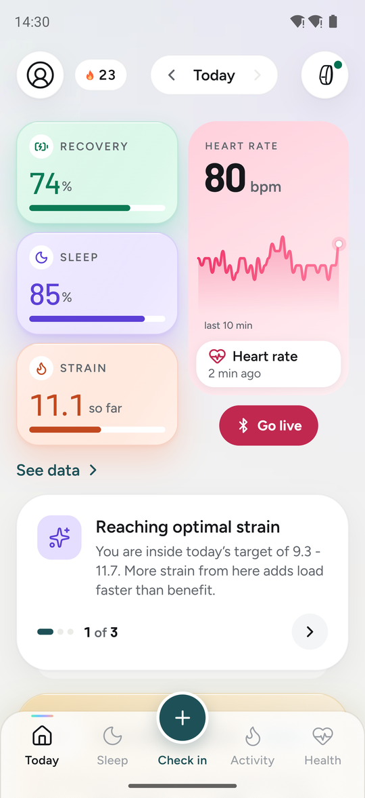
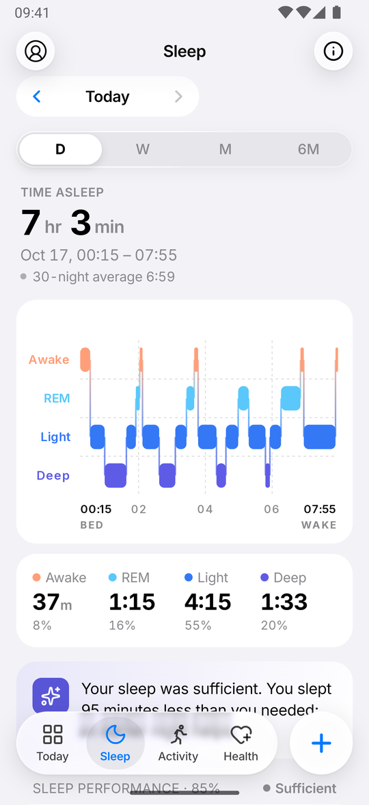
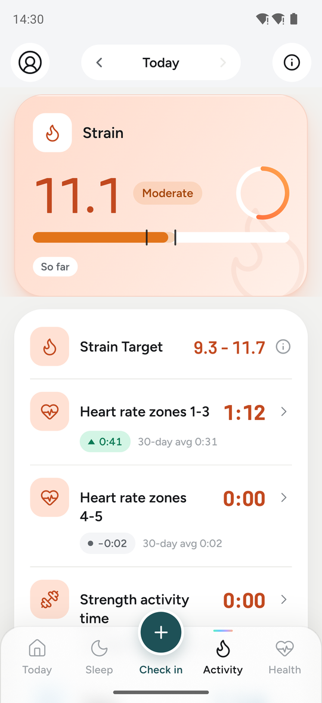
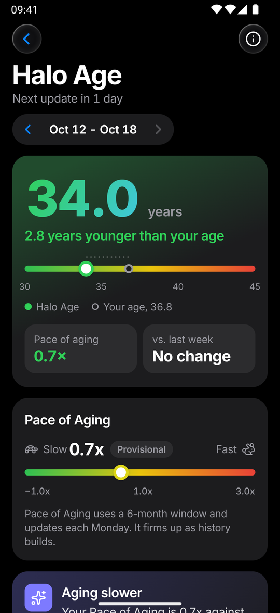
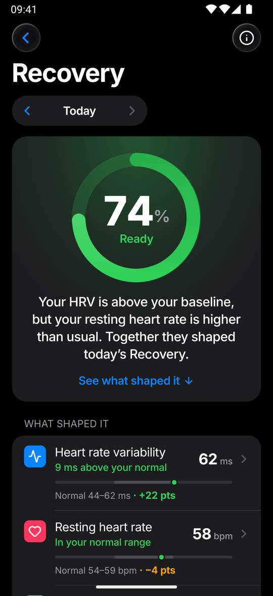
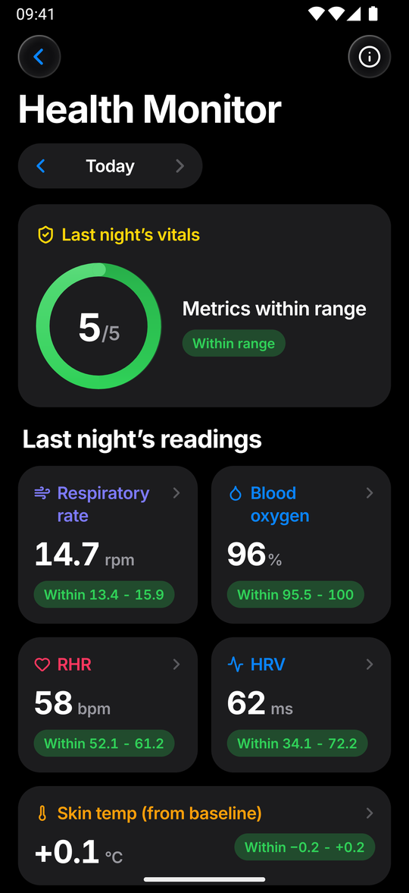

# Halo

A personal recovery, strain and sleep app for Android. Halo reads your Fitbit data from **Health Connect** and works everything out on the phone: no server, no account, nothing uploaded.

**Halo is not a medical device.** Its scores are estimates for personal insight, not medical advice.

## Screenshots

Taken with Halo's built-in demo data (a generated person, not real health data), in the light and dark themes.

<table>
  <tr>
    <td></td>
    <td></td>
    <td></td>
  </tr>
  <tr>
    <td align="center">Today</td><td align="center">Sleep</td><td align="center">Activity</td>
  </tr>
  <tr>
    <td></td>
    <td></td>
    <td></td>
  </tr>
  <tr>
    <td align="center">Halo Age (dark)</td><td align="center">Recovery (dark)</td><td align="center">Health Monitor (dark)</td>
  </tr>
</table>

## What it shows

- **Today**: Recovery, Strain and Sleep at a glance, daily goals, your journal and nutrition, the week in review.
- **Sleep**: Sleep Performance (hours against your need, consistency, efficiency and sleep stress), sleep need and debt, stages and timeline, and a bedtime planner.
- **Activity**: Day Strain and its heart-rate and muscular parts, workouts with Training Effect, Training Readiness, Training Status and training load, zones and minutes.
- **Health**: Halo Age and Pace of Aging, Recovery, HRV Status, Health Monitor, Stress, Fitness (VO2 max), heart rate, Trends and Nutrition.
- **Journal and Coach**: check-ins and their effect on your scores, a food log from a photo or a few words, weekly and monthly reports, and an AI coach that uses your own provider and key.

How each score is calculated is in the app under More › How Halo works. The research behind the WHOOP- and Garmin-style methods is in [docs/research/whoop-garmin.md](docs/research/whoop-garmin.md).

## Install

1. Download the latest `Halo.apk` from [Releases](../../releases) and open it on your phone. Android asks once to allow installs from that app.
2. Make sure the **Google Health** (Fitbit) app shares its data with Health Connect. On recent Android versions, Health Connect's own screen has **Sync your favourite apps with Google Health › Set up**: allow every data type.
3. Open Halo, enter your profile, tap **Connect Health Connect** and allow every permission, including access to past data. The first import reads the last 180 days.

Recovery needs 7 nights of HRV before its first score. More › Diagnostics shows what each app has written if a score stays empty.

## Updates

Halo checks this repository's [latest release](../../releases/latest) each time it opens, and in the background. When there's a newer version it shows a notification once and the update dialog every time you open the app, and **Update** downloads the release's APK and opens Android's installer (the first time, Android asks you to allow installs from Halo). The update installs over your current app and keeps your data. More › About › Check for updates checks at once.

For a release to be offered, its tag must be a higher version than the installed app (`v1.23.0`, matching `app.json`) and it must have the signed `.apk` attached.

## Report a bug

Open an [issue](../../issues/new). Include your phone model, Android version, Halo version (More › About) and what you did, what you expected and what happened.

## Privacy

Everything stays on your phone. Halo reads Health Connect and never writes to it. Two things leave the phone, only when you use them, and only to the AI provider you chose with your own API key: Coach questions (with the numbers its tools look up), and a food photo or description you ask Halo to estimate. The photo is scaled down, sent once and not kept.

Each time it opens, and in the background, Halo asks GitHub for its latest release, to tell you when an update is out. That request carries no health data or account; turn it off in Settings › Notifications › App updates.

## Develop

```sh
npm install --legacy-peer-deps     # react-dom peer clash in the Expo 57 tree
npm test                           # vitest
npx tsc --noEmit -p .
npx eslint src app
```

| Folder | What it is |
|---|---|
| `src/core` | The scoring: algorithms and score formulas, pure TypeScript with tests. |
| `src/pipeline` | The daily pipeline that turns imported rows into stored scores. `SCORING_VERSION` (in `types.ts`) rescores the history when it changes. |
| `src/queries` | The view models each screen reads. |
| `src/health` | Health Connect permissions, the record → row mapping and the sync. |
| `src/data` | Row types, SQLite storage, an in-memory store for tests and the demo-data generator. |
| `src/ui`, `src/screens`, `app/` | The design system and the screens (expo-router). |
| `src/google`, `modules/pulse-google` | A Google Health API source, switched off (`src/google/flags.ts`). |

### Build the APK

```sh
npm run build:apk                  # expo prebuild + gradlew assembleRelease
```

`android/` is generated by `expo prebuild` and isn't in the repo. Release builds are signed with `~/.pulse-mobile/release.keystore`. The passwords come from `~/.pulse-mobile/keystore.properties` (`storePassword=…`, `keyAlias=…`, `keyPassword=…`) or the `PULSE_KEYSTORE_*` environment variables, never from the repo (see `plugins/withReleaseSigning.js`). Keep that keystore safe: Android only installs an update over an existing install when it's signed with the same key.

## Credits

Halo stands on the work of others.

- **[Pulse](https://github.com/adityaongit/pulse)** by **Aditya Jindal** ([@adityaongit](https://github.com/adityaongit)). Halo began as an Android port of Pulse, a personal recovery, strain and sleep web app for the Fitbit Air. Its screens, daily pipeline, view models, many of its scores (stress, Health Monitor, baselines, the recovery forecast, journal impact, reports) and much of its explanatory text come from Pulse.
- **[noop](https://github.com/ryanbr/noop)** by **NoopApp**. Pulse's recovery, strain, sleep and readiness scoring, which Halo kept in large part (`src/core/scoring/`), is ported from noop's analytics engine.
- **[Hælan](https://github.com/bardesss/haelan)**. Its notes on how the Google Health API behaves shaped the (currently switched-off) Google source.
- **[OpenStrap analytics](https://github.com/OpenStrap/analytics)**. Its waking-heart-rate floor informed Day Strain's baseline.
- **Published science**: WHOOP's and Garmin/Firstbeat's published methods, patents and white papers, and the peer-reviewed studies cited in the code next to each formula. The sources are listed in [docs/research/whoop-garmin.md](docs/research/whoop-garmin.md).
- **Fonts**: [Figtree](https://fonts.google.com/specimen/Figtree) and [Barlow](https://fonts.google.com/specimen/Barlow), under the SIL Open Font License.

Halo is an independent, non-commercial project. It is not affiliated with, endorsed by or connected to WHOOP, Inc., Garmin Ltd., Firstbeat Analytics, Fitbit or Google. WHOOP, Garmin, Firstbeat, Fitbit and Google are trademarks of their owners and are named here only to describe where a method comes from. Halo's scores are its own implementation of published methods and use no code, data or assets from those companies.

## License

[PolyForm Noncommercial 1.0.0](LICENSE), as Pulse and noop are. You may use, change and share Halo for any noncommercial purpose; selling it, or putting it inside a commercial product, is not allowed. Anyone you share it with must receive the license and these notices:

> Required Notice: Copyright (c) 2026 Aditya Jindal (https://github.com/adityaongit)
>
> Required Notice: Copyright 2026 NoopApp (https://github.com/ryanbr/noop), for the scoring code ported in src/core/scoring/
